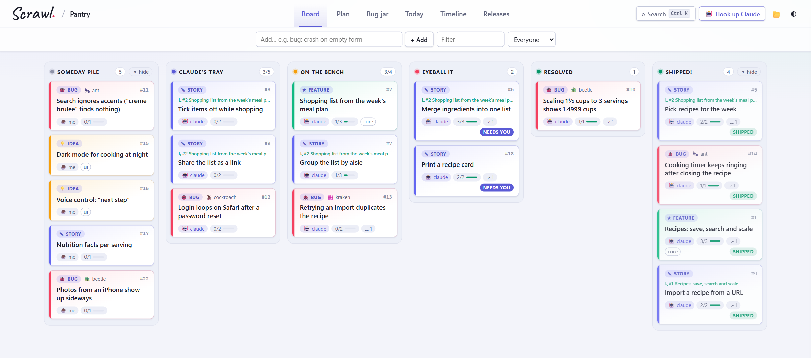
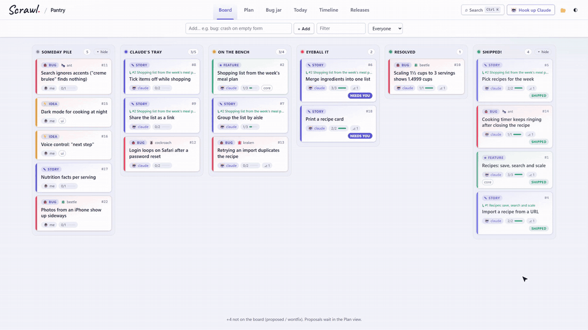
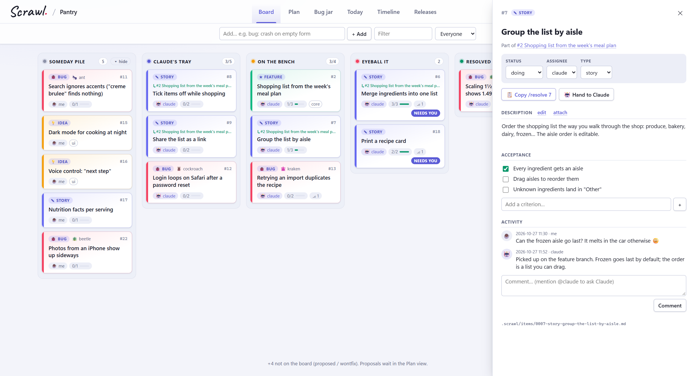
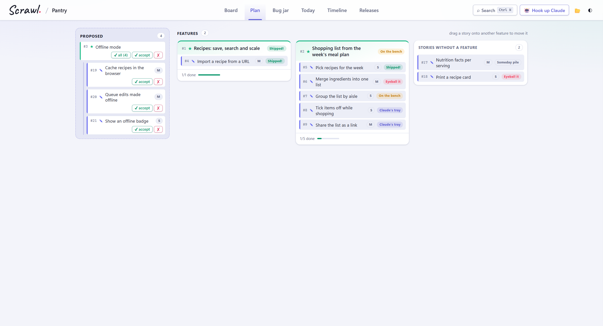
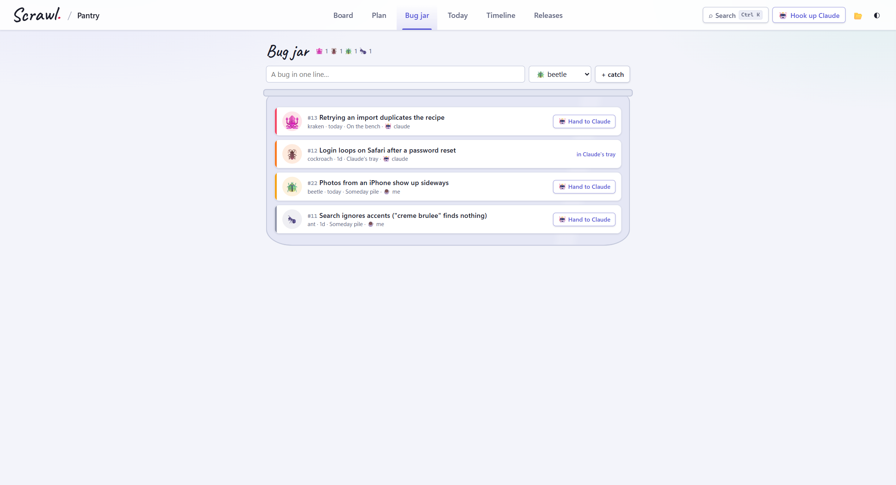
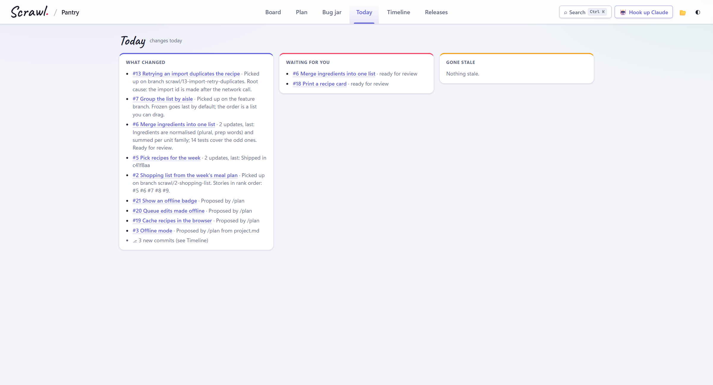
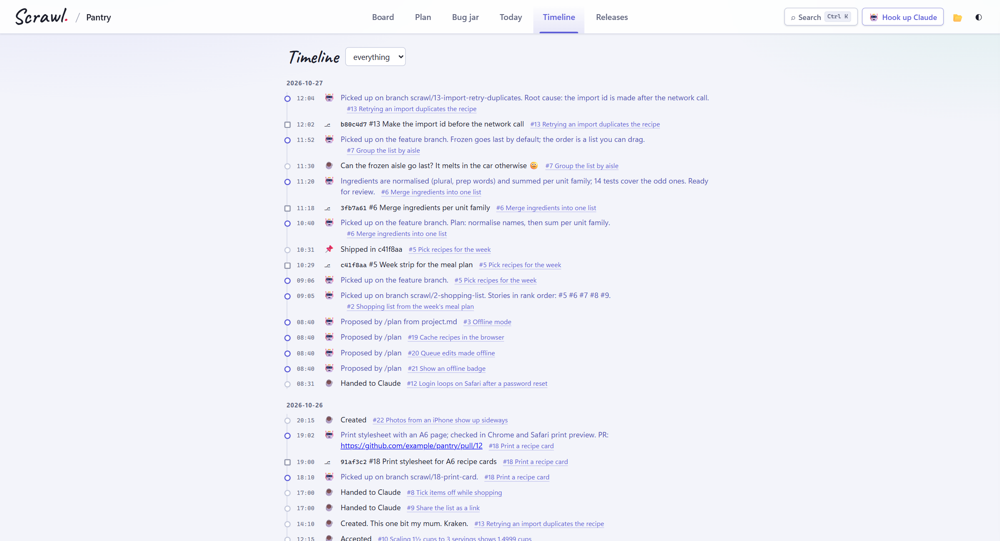
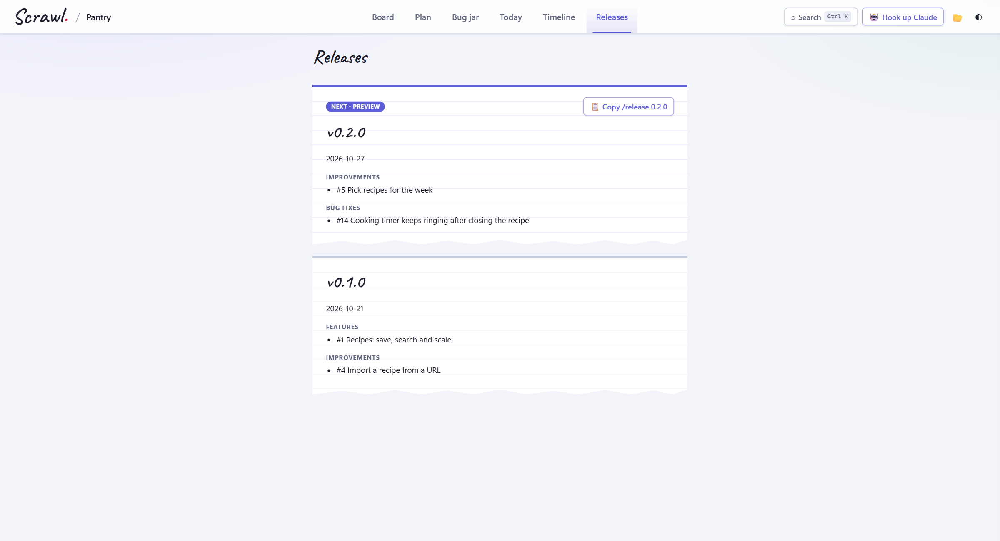
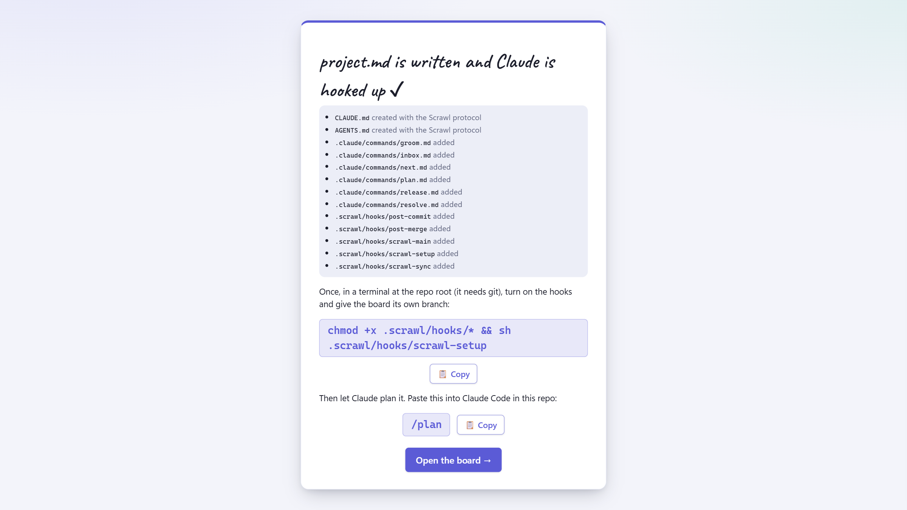
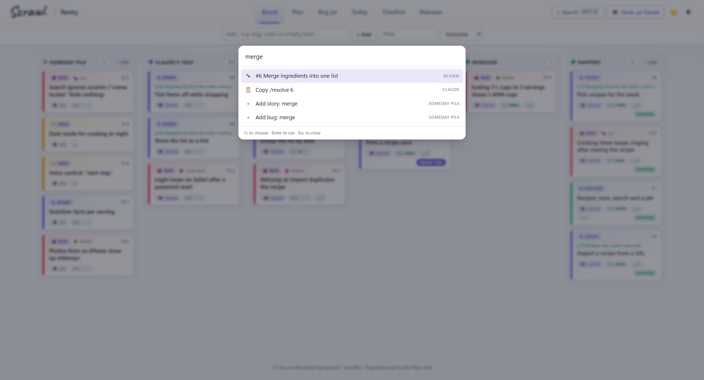

# Scrawl

A lightweight project board that lives in your repo. You and Claude Code share work through
plain Markdown files in `.scrawl/`. No server, no API, no database, no build step.

<picture>
  <source media="(prefers-color-scheme: dark)" srcset="docs/media/board-dark.png">
  
</picture>

**[⬇ Download scrawl.html](https://github.com/atulprakash1/scrawl/releases/latest/download/scrawl.html)**:
one file, open it in Chrome or Edge, pick your repo.

## See it work



You jot work down, hand a card to Claude, and Claude Code picks it up from the same files: the card
moves to *On the bench*, then *Eyeball it* with a PR to review. Merge it and the card ships. The board
never talks to Claude; it just watches the files you both edit.

## What you get

| | |
|---|---|
|  | **Cards are Markdown files.** Description, acceptance boxes and an append-only activity log. Comment with `@claude` and `/inbox` answers. **Hand to Claude** puts it in Claude's tray; `/next` takes the top one. |
|  | **Plan.** Describe the project once; `/plan` proposes features and stories. Accept a feature with all its stories in one click, and watch each one's progress. |
|  | **Bug jar.** Bugs come in four sizes, from 🐜 ant to 🐙 kraken. Catch one in a line, hand the worst to Claude. |
|  | **Today.** What Claude did while you were away, what's waiting for your review, and what has gone stale. |
|  | **Timeline.** Every comment, move and commit, linked to its card. Commits starting with `#42` land on card #42. |
|  | **Releases.** `/release 1.2.0` writes the notes from what shipped and tags `main`. The next release is previewed as you go. |
|  | **Set up in a minute.** A five-question wizard writes `project.md`, installs the Claude protocol, commands and git hooks, and leaves one command to paste. |
|  | **Keyboard first.** <kbd>Ctrl</kbd>+<kbd>K</kbd> finds any card or runs a command. Light and dark themes. |

**Why it's nice to live with:** the board stays out of your project's git (it has its own branch),
Claude never marks its own work done, every change is a readable diff, and it works offline from
`file://`.

## Requirements

- **Chrome or Edge**, to open the board (Firefox and Safari can only show it read-only)
- **git**, and a POSIX `sh` for the hooks: built into macOS; on Windows, Git Bash (part of Git for Windows)
- A GitHub remote named **`origin`**: the board syncs there and Claude's PRs go there
- The **GitHub CLI** (`gh`), logged in with `gh auth login`: `/resolve` opens PRs with it
- **Claude Code**, or another coding agent that reads `AGENTS.md`

`scrawl-setup` warns when the remote or `gh` is missing; the board itself still works locally without them.

## Use it

1. Open `scrawl.html` in **Chrome or Edge** (double-click is fine).
2. Click **Open project folder** and pick this repo's root folder. Allow edit access.
3. Drag cards, open one to comment, tick acceptance boxes, or **Hand to Claude**.
4. In Claude Code, paste `/resolve <n>` (the drawer has a copy button) or `/next`.
   The card moves to *On the bench*, then *Eyeball it* with a linked commit. You ship it.

### In another repo

Download [`scrawl.html`](https://github.com/atulprakash1/scrawl/releases/latest/download/scrawl.html)
from the latest release: the whole board in one file. Put it in the other repo, open it, click **Start Scrawl**
and answer the project wizard. Finishing it hooks up Claude: it writes the protocol into `CLAUDE.md` (and
`AGENTS.md`, for other coding agents such as Codex, Gemini CLI or Cursor), the slash commands into
`.claude/commands/` and the git hooks into `.scrawl/hooks/`, without overwriting your own `CLAUDE.md` text or
commands. Paste the setup command it shows into a terminal once, then `/plan` into Claude Code.
(**🤖 Hook up Claude** on the board does the same again, e.g. to refresh the hooks after updating Scrawl.)

Changed Scrawl itself? `node tools/bundle.mjs` (Node 18+, nothing to install) builds the same file in `dist/`.

Firefox and Safari can't write to folders. If `file://` gives you trouble, serve it locally:
`python -m http.server` (or `npx serve`) and open `http://localhost:8000/scrawl.html`.

## Setup (once per clone)

The board stays out of your project's git. `.scrawl/` is checked out from its own `scrawl-board`
branch (a separate git worktree, listed in `.git/info/exclude`), so moving cards never shows up in
`git status`, diffs or PRs, and switching branches never touches the board.

On a fresh clone there's nothing to do by hand: the first `/next` or `/resolve` in Claude Code sees that
`.scrawl/` is missing and checks the board out (the protocol in `CLAUDE.md` tells it how). Opening
`scrawl.html` first shows the same command to paste instead:

```sh
git worktree add .scrawl scrawl-board && sh .scrawl/hooks/scrawl-setup
```

Starting Scrawl in a new folder? Run just `sh .scrawl/hooks/scrawl-setup` (the wizard shows it): it moves
the plain `.scrawl/` folder onto the `scrawl-board` branch, excludes it from the project's git and installs
the hooks. (If your code branch still tracks `.scrawl/`, it tells you to untrack it first.)

On Windows, run it in Git Bash as above, or in PowerShell through Git's own shell:

```powershell
& "$env:ProgramFiles\Git\bin\sh.exe" .scrawl/hooks/scrawl-setup
```

Every commit is then logged to `.scrawl/log/commits.txt`, and commits whose message starts with
`#42` show up on card #42. The hooks also list the commits on `main` in `.scrawl/log/main.txt`.
Both are rebuilt from git history when missing and never committed, nor is `index.json`.

## Flow

Someday pile → Claude's tray → On the bench → Eyeball it → **Accept** → Resolved → Shipped!

Nothing goes to `main` directly. For each card Claude works on a branch `scrawl/<id>-<slug>`,
pushes it and opens a PR, and the card lands in *Eyeball it*. You review and merge the PR on GitHub
(merge, squash or rebase all work). **Accept** is optional: it parks the card in *Resolved* while
the PR waits to be merged.

You never `git pull` by hand: every `/resolve` and `/next` starts with `.scrawl/hooks/scrawl-sync`,
which fast-forwards `main` from GitHub, then commits the board's changes (moves, comments, Claude's
notes) on `scrawl-board` and pushes them. The board then ships every card whose work is on `main`.
Code PRs carry code only.
*Shipped!* lists the most recently shipped first; **▾ hide** tucks its cards away without changing its width.

## Layout

```
scrawl.html            the board (open in Chromium)
app/js, app/css        plain classic scripts and styles
vendor/                SortableJS, marked, DOMPurify, fonts (no CDN at runtime)
templates/hooks/       the git hooks that Hook up Claude installs in .scrawl/hooks/
tools/bundle.mjs       builds app/js/templates.js and the single-file dist/scrawl.html
CLAUDE.md              the protocol Claude follows
.claude/commands/      /resolve, /next, /plan, /groom, /inbox, /release
.scrawl/               the board, from the scrawl-board branch: project.md, config.json, items/,
                       log/, hooks/, releases/ (plus the rebuilt index.json)
docs/media/            the screenshots and demo in this README
```

## Releasing

`/release <version>` in Claude Code does it all; its steps are in
[`.claude/commands/release.md`](.claude/commands/release.md). It writes the notes for every shipped card
to `.scrawl/releases/v<version>.md`, tags `main` and pushes the tag. In this repo it also builds
`dist/scrawl.html` from the tag and attaches it to the GitHub release, which is what the download link
above points to.

## License

MIT, see [LICENSE](LICENSE). The libraries and fonts in `vendor/` keep their own licenses, listed in
[vendor/NOTICE.md](vendor/NOTICE.md).
